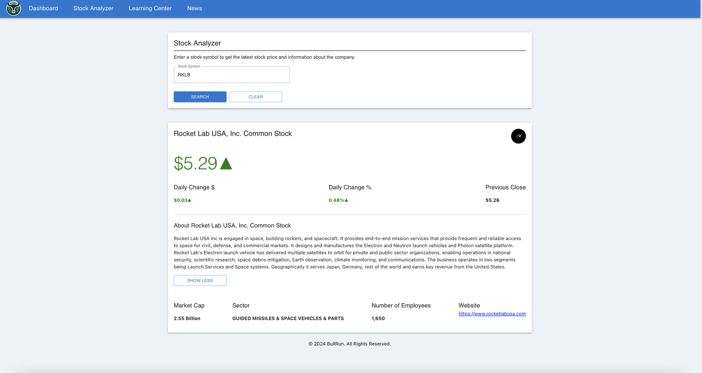
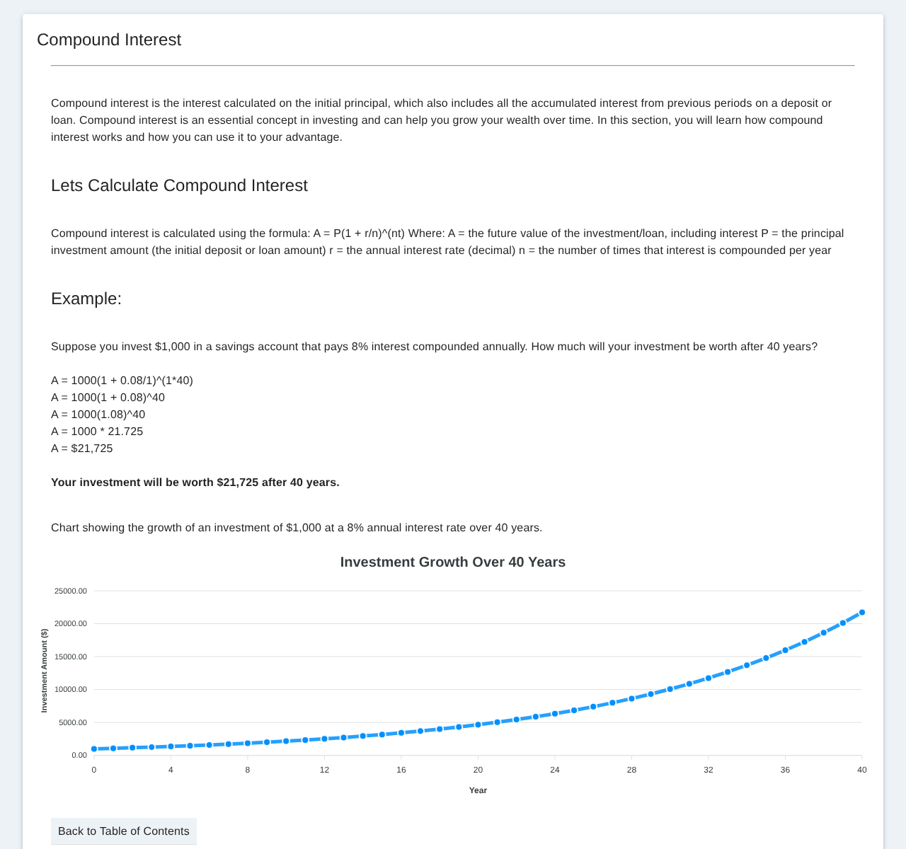
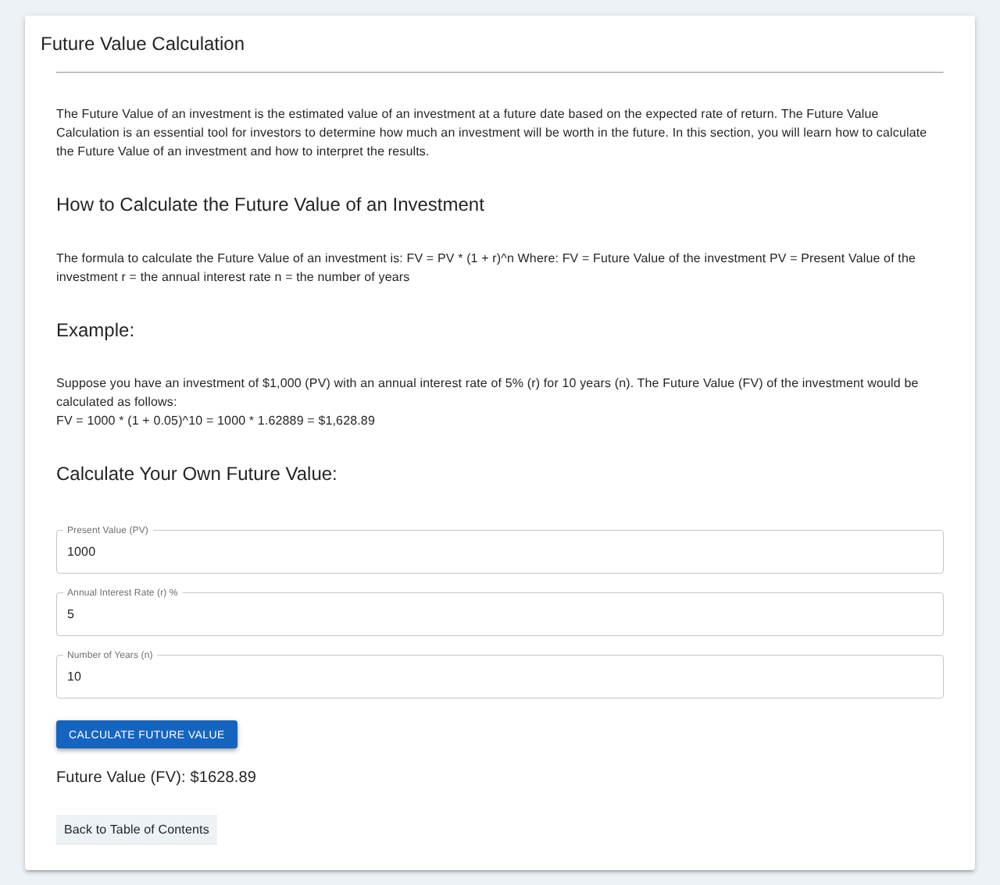
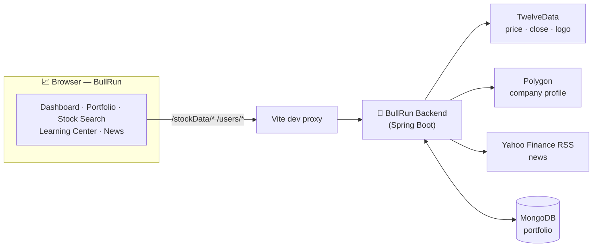
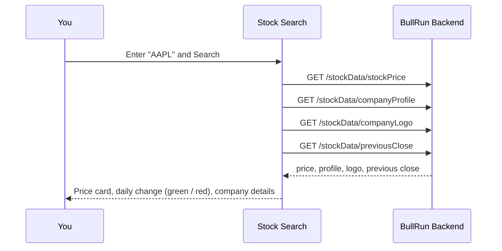

<p align="center">
  
</p>

<p align="center">
  
  
  
  
  
  
</p>

# BullRun

A React app for managing a stock portfolio and building financial literacy. Look up any ticker, keep track of the shares you own, read the latest headlines, and learn the concepts behind it all (compound interest, P/E ratio, dividend yield, fair value) in the Learning Center.

BullRun is the frontend half of the project. Market data, news and portfolio storage come from the [BullRun Backend](https://github.com/jlthompson96/BullRun_Backend), a Spring Boot API.

<p align="center">
  
  <br><sub>Stock Search with live data (captured in 2024, when the page was called Stock Analyzer).</sub>
</p>

## Features

<p align="center">
  
</p>

- **Stock Search.** Enter a symbol (AAPL, TSLA, MSFT, GOOGL, AMZN…) to get the latest price, the daily change in dollars and percent, the previous close, the company logo and profile, market cap, sector, employee count and website. Price and change turn green or red with the day's move.
- **Portfolio.** A sortable, paginated grid of your holdings (symbol, company, close price, shares owned, current value) with the total current value underneath. Add a stock, update the shares you own, or remove a holding.
- **Learning Center.** Short lessons on stock market basics, investing, compound interest, the P/E ratio, dividend yield, fair value and future value, each with a worked example. Includes an ApexCharts growth curve and a future value calculator you can try.
- **News.** Enter a ticker to pull its latest headlines, with descriptions and publish times.
- **Dashboard.** The landing page that ties the app together.
- **Responsive navigation.** The top app bar collapses into a drawer on small screens.

## Screenshots

<table>
  <tr>
    <td width="50%"></td>
    <td width="50%"></td>
  </tr>
  <tr>
    <td align="center"><b>Compound interest</b>: $1,000 at 8% over 40 years</td>
    <td align="center"><b>Future value calculator</b>: try your own numbers</td>
  </tr>
</table>

## How it works

The browser only talks to the Vite dev server. Vite proxies `/stockData` and `/users` to the BullRun backend, which calls the market data providers and stores the portfolio in MongoDB.



What happens when you search for a ticker:



## Tech stack

React 18, TypeScript, Vite, MUI 6 (with `@mui/x-data-grid`), Axios, React Router, ApexCharts and Sass.

## Getting started

### Prerequisites

- Node.js 22 (see `engines` in [package.json](package.json))
- A running [BullRun Backend](https://github.com/jlthompson96/BullRun_Backend) for live data. The Learning Center works without it.

### Install and run

```bash
git clone https://github.com/jlthompson96/BullRun_Frontend.git
cd BullRun_Frontend
npm install
npm run dev
```

Open http://localhost:5173.

The dev proxy in [vite.config.ts](vite.config.ts) forwards `/stockData` and `/users` to the hosted backend. To use a backend running on your machine, change both targets to its address, for example `http://localhost:8080`.

## Scripts

| Command | Description |
| --- | --- |
| `npm run dev` | Start the Vite dev server with the API proxy |
| `npm run build` | Type-check and build for production into `dist/` |
| `npm run preview` | Serve the production build locally |
| `npm run lint` | Run ESLint with `--fix` |

## Project structure

```
src/
├── App.tsx              # Theme provider, app bar and footer
├── common/              # App bar + routes, footer, shared types, compound-interest chart
├── components/          # Add stock / update shares modals, index ticker, stock data
├── routes/              # Dashboard, Portfolio, Stock Search, Learning Center, News
└── service/             # Axios instance, stock and user API calls
```
